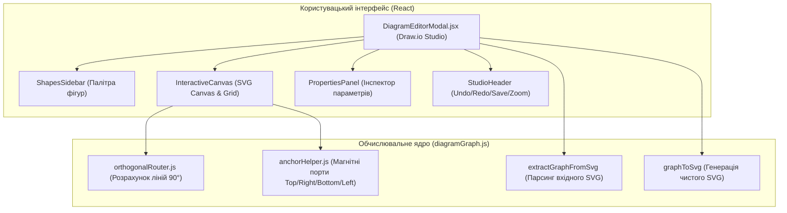

# Технічна специфікація: Професійний Canvas-редактор діаграм у стилі Draw.io для Code2UML

## 1. Огляд та цілі

Створення сучасного, ергономічного та візуально довершеного редактора блок-схем, UML-activity діаграм та структурних схем взаємодії функцій на основі перевіреного UX стандарту **draw.io (diagrams.net)**.

### Ключові цілі:
1. **Ідеальна контрастність у темній та світлій темах**: повне усунення невидимості ліній/з'єднань на темному тлі, тема-адаптивні кольори фігур, обводок, текстів, стрілок та сітки.
2. **Магнітні порти з'єднань (Anchor Connection Ports)**: 4 порти (Top, Bottom, Left, Right) на кожній фігурі з інтерактивним витягуванням та примагнічуванням стрілок при наведенні.
3. **Розумне ортогональне трасування (Orthogonal / Manhattan 90° Routing)**: автоматичний розрахунок ламаних ліній під кутом 90° між портами з можливістю ручного пересування точок згину (waypoints).
4. **Професійна 3-панельна компоновка draw.io**:
   - **Ліва панель**: Shapes Library (палітра стандартних фігур ДСТУ 19.701-90 та UML).
   - **Центральне полотно**: SVG Canvas із координатною сіткою, масштабуванням (20% – 300%), плавним панорамуванням (Drag полотна або Space+Drag), виділенням та переміщенням блоків.
   - **Права панель**: контекстний інспектор форматування (текст, тип фігури, геометрія, підписи стрілок, стрілки на кінцях, тип лінії).
5. **Ергономіка та клавіатурні скорочення**: підтримка `Ctrl/Cmd+Z` (Undo), `Ctrl/Cmd+Y` / `Ctrl+Shift+Z` (Redo), `Delete`/`Backspace` (видалення), `Ctrl/Cmd+D` (дублювання), подвійний клік для інлайн-редагування тексту.
6. **Двостороння цілісність із експортом**: відредагований граф перетворюється у валідний, чистий SVG для перегляду та експорту в SVG/PNG без втрати якості.

---

## 2. Архітектура модулів



### 2.1. Модулі:
1. **`src/utils/diagramGraph.js`**:
   - `extractGraphFromSvg(svgString, diagramType)`: витягує координати, типи блоків, тексти та зв'язки.
   - `graphToSvg(graph, options)`: генерує фінальний чистий SVG (підтримує тему `light`/`dark`).
   - `calculateOrthogonalPath(p1, dir1, p2, dir2, obstacles)`: розраховує ортогональні точки шляху між портами.
   - `getNodeAnchorPoints(node)`: повертає точні координати 4 портів `{ top, bottom, left, right }`.
2. **`src/components/DiagramEditorModal.jsx`**:
   - Повноцінний Draw.io Studio інтерфейс.
   - Стани: `graph`, `undoStack`, `redoStack`, `selection`, `connectingPort`, `dragState`, `viewport`.
3. **`src/App.css`**:
   - Високоякісні стилі для темної та світлої теми, тіні, маркери, сітка, прев'ю фігур.

---

## 3. Схема даних (Graph Data Model)

```typescript
interface Node {
  id: string;
  type: "process" | "predefined" | "rhombus" | "input" | "output" | "start" | "end" | "uml-action" | "structure-chart-node";
  cx: number;
  cy: number;
  w: number;
  h: number;
  text: string;
  isPredefined?: boolean;
  isUml?: boolean;
  fill?: string;
  stroke?: string;
}

interface Edge {
  id: string;
  sourceNodeId?: string;
  sourcePort?: "top" | "bottom" | "left" | "right";
  targetNodeId?: string;
  targetPort?: "top" | "bottom" | "left" | "right";
  points: Array<{ x: number; y: number }>;
  hasArrow: boolean;
  isOrthogonal: boolean;
  label: string;
  labelPos?: { x: number; y: number };
}
```

---

## 4. Контрастність та колірна палітра

| Елемент | Світла тема (`light`) | Темна тема (`dark`) |
| :--- | :--- | :--- |
| **Фон полотна** | `#f8fafc` | `#0b1120` (глибокий синьо-чорний) |
| **Сітка (Grid)** | `#cbd5e1` (крапки або лінії) | `#1e293b` (м'які контрастні лінії) |
| **Заливка блоку** | `#ffffff` | `#1e293b` |
| **Рамка блоку** | `#334155` | `#94a3b8` (світло-графітовий) |
| **Текст блоку** | `#0f172a` | `#f8fafc` (чистий білий) |
| **Колір стрілок** | `#334155` | **`#60a5fa` / `#93c5fd` (яскравий синій/блакитний)** |
| **Наконечник стрілки** | `#334155` | **`#60a5fa`** |
| **Магнітні порти** | `#2563eb` з білою обводкою | `#38bdf8` з темно-синьою обводкою |
| **Виділення** | `#2563eb` (синій) | `#60a5fa` з неоновим свіченням |

---

## 5. План верифікації
1. **Лінтер та білд**: `npm run lint` — 0 errors/warnings, `npm run build` — успішна компіляція.
2. **Тести лабораторних робіт**: `node scripts/test_all_labs.mjs` — успішно.
3. **Функціональні тести**:
   - Перевірка створення ортогональної стрілки з порту блоку A до порту блоку B.
   - Перевірка слідування стрілки при переміщенні блоку.
   - Перевірка видимості стрілок та тексту в темній темі.
   - Перевірка експорту відредагованої діаграми у файл SVG/PNG.
